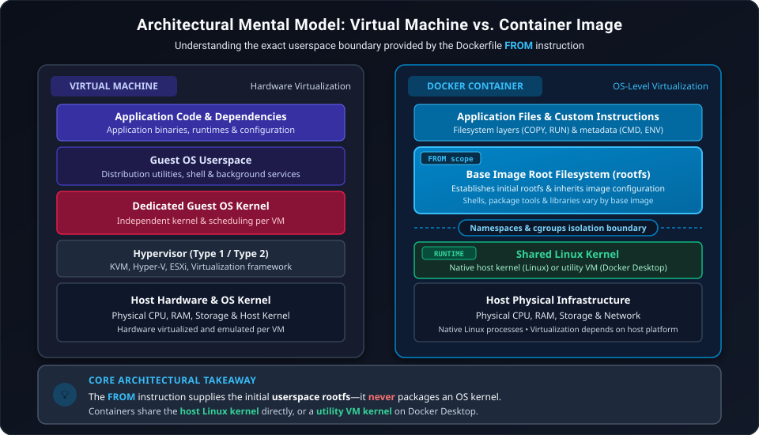
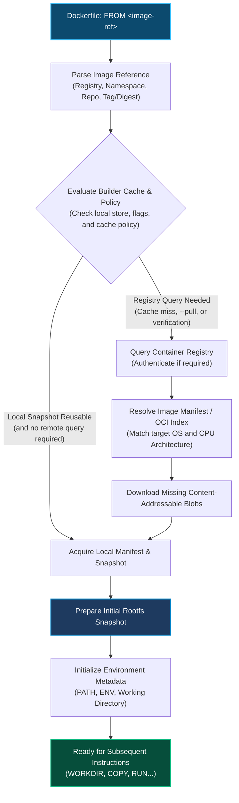
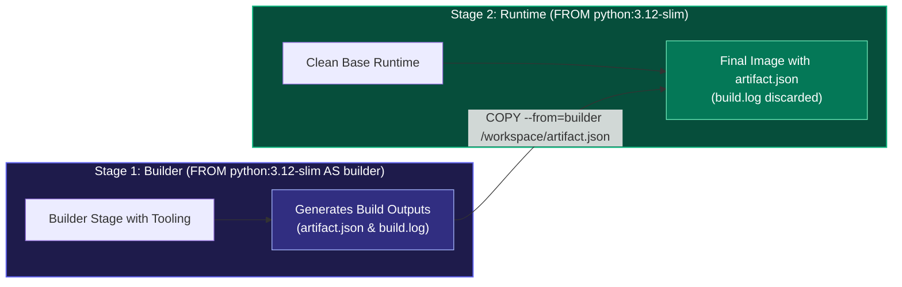

# FROM Explained: How Docker Images Get Their Foundation

---

## 1. Chapter Overview & Mental Model

### 1.1 The Genesis of Container Images

Every Docker build begins with an essential question: *Where does the filesystem start?*

In a Dockerfile, image definition starts with a foundational instruction:

```dockerfile
FROM python:3.12-slim
```

While resembling a language import, `FROM` initializes the container's **root filesystem (`rootfs`)**. The contents of this rootfs depend entirely on the base image: general-purpose distributions provide complete userspace shells, package managers, and core utilities, whereas minimal, distroless, or `scratch` images intentionally omit some or all of these tools to minimize attack surface.

**Distinguishing `FROM` from `COPY`:**
It is essential to distinguish the role of `FROM` from that of `COPY`. The `FROM` instruction establishes the initial userspace rootfs and runtime configuration inherited from an existing parent image or earlier build stage. In contrast, `COPY` transfers specific files and directories from the host build context (the local project files passed to `docker build`) into that newly initialized rootfs. `FROM` sets the foundation; `COPY` adds application-specific assets on top of it.

In traditional infrastructure, environments often evolved through sequential, manual configuration:

```
Traditional Host Provisioning (Manual Configuration):
[Bare Metal / Hypervisor] ──> [OS Installation] ──> [System Libraries] ──> [Runtime] ──> [Application]
```

Over time, discrepancies across machines (configuration drift) could make reproducing identical execution environments challenging. The `FROM` instruction replaces manual host setup with **declarative filesystem inheritance**:
- **Standard Baselines**: Builds inherit tested base images maintained by upstream distribution teams.
- **Layered Construction**: Images assemble as ordered, immutable filesystem snapshots anchored by `FROM`.
- **Reproducible Delivery**: Referencing an immutable base image manifest digest locks the exact starting filesystem on a given platform, avoiding unexpected upstream changes.

### 1.2 What You Will Learn & Prerequisites

This chapter covers:
- **Base Image Architecture**: Userspace rootfs vs. host kernel process isolation.
- **Internal Resolution**: Cache evaluation, registry queries, and layer unpacking.
- **Image Trade-Offs**: Comparing Full, Slim, Alpine, and `scratch` across `glibc`/`musl` compatibility and security.
- **Multi-Stage Builds**: Isolating intermediate build stages from runtime deliverables.
- **Troubleshooting**: Diagnosing authentication, rate limits, architecture mismatches, and dynamic linker errors.

**Prerequisites**: Basic terminal experience and an active Docker daemon.
**Estimated Reading Time**: 12–15 minutes.

---

## 2. The Visual Mental Model

### 2.1 Container Stack vs. Virtual Machine Architecture

Understanding `FROM` requires distinguishing hardware-level virtualization from container-based process isolation:
- **Virtual Machines (VMs)**: A hypervisor virtualizes physical hardware. Each VM boots an independent guest operating system—including its own kernel, device drivers, and system daemons—allocating dedicated virtual memory and virtualized devices.
- **Containers**: Containers do not virtualize hardware or run a separate operating system. Instead, containers package application files and runtime dependencies into a userspace rootfs, executing directly as isolated Linux processes that share the host Linux kernel via namespaces (for visibility isolation) and control groups (`cgroups`, for resource metering).



*Figure 1: Architectural comparison between a Virtual Machine and a Container Image foundation.*

### 2.2 What a Base Image Contains (and Never Contains)

Container userspace contents depend entirely on the chosen base image. General-purpose distributions (e.g., `debian:bookworm-slim`, `python:3.12-slim`) package standard userspace tooling; minimal, distroless, or `scratch` images omit many or all of them:
- **Root Filesystem Layout (`rootfs`)**: Standard directories (`/bin`, `/etc`, `/lib`, `/usr`, `/var`, `/tmp`); empty in `scratch`.
- **C Standard Library**: Shared libraries (`glibc` or `musl libc`) enabling dynamic binaries to make system calls.
- **Core Utilities & Shells**: Command-line tools (`sh`, `ls`, `cat`) when packaged by the distribution.
- **Package Manager**: Distribution tools (`apt` on Debian, `apk` on Alpine; omitted in distroless/scratch).
- **Metadata & Runtimes**: Default environment variables (`PATH`), working directories, and language binaries (e.g., Python).

Conversely, a container does not boot or manage its own operating system kernel:
- **No Operating System Boot**: Containers do not execute an OS boot sequence or initialize a separate kernel (`vmlinuz`). They execute directly against the shared host kernel (or utility VM kernel).
- **Kernel Space Execution**: Hardware device drivers and CPU/memory scheduling reside strictly in the executing kernel space on the host, not inside container image layers.
- **Process Execution**: Containers typically launch application processes directly as PID 1, rather than booting system init daemons (such as `systemd`), unless explicitly configured for specialized container environments.

> [!NOTE]
> **Host Kernel Qualification for Docker Desktop:**
> On native Linux, containers share the host Linux kernel directly. On Docker Desktop (macOS/Windows), containers execute inside a lightweight Linux utility VM, sharing its Linux kernel rather than the Darwin or Windows NT kernel.

---

## 3. How `FROM` Works Internally

### 3.1 Anatomy of an Image Reference

The argument supplied to `FROM` is an **OCI image reference** parsed as follows:

```
docker.io / library / python : 3.12-slim
└──┬────┘   └───┬───┘ └───┬──┘   └───┬─────┘
Registry    Namespace  Repository    Tag
```

1. **Registry**: Host serving manifests (defaults to `docker.io` when omitted).
2. **Namespace / Organization**: Account or team space (`library` for official Docker Hub images).
3. **Repository**: Canonical image name (`python`, `node`, `alpine`).
4. **Tag or Digest**:
   - **Tag (`:3.12-slim`)**: Mutable pointer to an underlying manifest.
   - **Digest (`@sha256:...`)**: Cryptographic SHA-256 hash identifying an immutable manifest or multi-architecture image index.

### 3.2 Resolution and Build Flow

Image resolution is conditional and builder-dependent. Modern builders (such as BuildKit) construct a dependency graph, evaluating local cache state, content-addressable storage, and CLI flags (`--pull`) to determine whether to query remote registries or reuse local layers. While omitting `--pull` typically encourages local cache reuse, it does not strictly guarantee that no registry queries will take place; specific builder configurations, cache policies, or remote manifest checks may still trigger network calls:



*Figure 2: Conceptual model of conditional image resolution. Exact execution steps, cache checks, and registry queries vary depending on builder engine (BuildKit vs. legacy), storage driver, and CLI build flags.*

**Key Architectural Rules:**
1. **Conditional Resolution**: Modern builders evaluate local cache availability, build options, and manifest freshness. Omitting `--pull` favors local cache reuse, but the builder may still issue registry requests depending on its configuration, cache policies, or missing content blobs.
2. **Architecture Matching**: The builder inspects the OCI Index (manifest list) and selects the manifest matching host architecture (`linux/amd64`, `linux/arm64`). *(Covered in Chapter 27: OCI Image Specification).*
3. **Layer Unpacking**: Missing blobs are downloaded by content digest and unpacked into a read-only rootfs snapshot.

> [!IMPORTANT]
> **Does `FROM` Create a New Filesystem Layer?**
> No. `FROM` initializes a build stage or selects a base image; it creates no filesystem diff layer. Diff layers are created only by disk-writing instructions (`RUN`, `COPY`, `ADD`). *(Covered in Chapter 06: Docker Layers).*

### 3.3 Tags vs. Content Digests: Mutability and Reproducibility

Choosing between tags and digests balances maintenance convenience against build reproducibility:
- **Tag References (`FROM python:3.12-slim`)**: Image maintainers update mutable tags with security patches and upstream releases. However, local builds do not automatically fetch tag updates unless explicitly pulled or rebuilt with `--pull`. Furthermore, rebuilding over time can introduce unexpected changes if a tag points to a newer image revision.
- **Digest References (`FROM python@sha256:...`)**: Digests reference the immutable cryptographic SHA-256 hash of a specific image manifest or multi-platform index.

> [!NOTE]
> **OCI Image Index vs. Platform Manifest Digest:**
> Public base images typically publish an **OCI Image Index** (multi-architecture manifest list). An index digest is immutable, but resolves to different platform manifests for `linux/amd64` versus `linux/arm64`. To guarantee single-architecture byte-for-byte reproducibility across all hosts, pin the platform manifest digest directly or specify `--platform` alongside the index digest.

> [!WARNING]
> **The Determinism Fallacy:**
> Pinning a base image digest combined with a fixed target platform locks the exact starting userspace layers, but does not guarantee a byte-for-byte reproducible final build. Downstream instructions often introduce non-determinism through network package installations (e.g., floating dependencies via `apt-get` or `pip`), build timestamps, dynamic file generation, and compiler flags. True build reproducibility requires deterministic downstream instructions and locked dependency trees in addition to pinned base digests and platforms.

---

## 4. Understanding Base Image Choices

Base image selection is an architectural trade-off across binary compatibility, attack surface, operational tooling, and image weight.

### 4.1 Comparative Analysis Matrix

| Base Image Category | Example Image | Relative Size Profile* | C Standard Library | Package Manager | Debug Tooling? | Primary Trade-Off / Typical Use Case |
| :--- | :--- | :--- | :--- | :--- | :--- | :--- |
| **Full Runtime** | `python:3.12` | Larger (Full distribution) | GNU C (`glibc`) | `apt` (Debian) | Yes (full shell, build tools, curl) | Broad compatibility; ideal for build stages requiring C compilers and build tools. |
| **Slim Runtime** | `python:3.12-slim` | Smaller (Slimmed runtime) | GNU C (`glibc`) | `apt` (minimal) | Moderate (shell, coreutils) | Minimal glibc-based runtime balancing binary wheel compatibility with reduced image footprint. |
| **Alpine Linux** | `python:3.12-alpine` | Minimal (Trimmed userspace) | `musl libc` | `apk` | Minimal (BusyBox shell) | Ultralight footprint; ideal for stateless services without native C extension requirements. |
| **Empty / Scratch** | `scratch` | Empty | None | None | None (no shell or utilities) | Zero-overhead baseline; requires bundling all runtime dependencies or static binaries. |

*Note: Relative size comparisons reflect typical userspace footprints. Actual compressed transfer sizes and uncompressed rootfs footprints on disk vary across CPU architectures, upstream distribution patch levels, and release cycles.

### 4.2 C Standard Library & Compatibility Trade-offs

The C standard library interfaces application processes with the Linux kernel:
- **`glibc` (Debian, Ubuntu, Slim)**: Standard across most Linux distributions. Most pre-compiled binary packages and language wheels (e.g., standard `manylinux` wheels for Python libraries like NumPy or cryptography) target `glibc`.
- **`musl libc` (Alpine Linux)**: Lightweight, standards-focused C library. Because many pre-compiled binary packages target `glibc`, Python package installers (such as `pip`) that cannot find a compatible binary wheel for `musl` (`musllinux`) will fall back to building native C extensions from source. This requires installing compilers (e.g., `gcc`, `musl-dev`) into the build stage, significantly increasing build times. *(Image optimization is covered in Chapter 24).*

**The "Smallest Image" Fallacy:**
Defaulting to Alpine solely for disk savings overlooks three operational realities:
1. **Build Duration**: Compiling native extensions from source when binary wheels are unavailable during CI frequently negates storage savings.
2. **Vulnerability Posture**: Minimal images reduce attack surface, but security posture depends on upstream patch velocity. Smaller images are not unconditionally more secure than well-maintained `slim` baselines.
3. **Debug Ergonomics**: Troubleshooting production containers lacking basic utilities (`curl`, `ip`, POSIX shell) requires specialized debug sidecars.

### 4.3 The Role of `FROM scratch`

Docker reserves `scratch` as an empty, zero-byte pseudo-image:

```dockerfile
FROM scratch
```

Because `scratch` is an empty rootfs, it provides no shell, dynamic linker, or CA certificates:
- **Statically compiled binaries** (e.g., Go or Rust with static linking) run cleanly on `scratch` without external shared libraries or a dynamic loader.
- **Dynamically linked binaries** fail (`exec /app: no such file or directory`) unless all required shared libraries and the dynamic linker (`/lib64/ld-linux-x86-64.so.2` or `/lib/ld-musl-*.so.1`) are explicitly copied into the image at their expected paths.
- **Supporting files and certificates**: Because `scratch` has no root filesystem, all configuration, timezone data, and TLS root CA certificates (`/etc/ssl/certs/ca-certificates.crt`) must be explicitly supplied for network calls.

---

## 5. Multiple `FROM` Instructions: Multi-Stage Builds

### 5.1 Decoupling Build Tooling from Runtime

Single-stage Dockerfiles frequently leak intermediate artifacts, temporary caches, and sensitive build logs into published container images. **Multi-stage builds** solve this by using multiple `FROM` instructions to enable **selective artifact transfer**: intermediate files remain isolated in early stages, and only explicitly designated deliverables are transferred into the final runtime image.

### 5.2 Anatomy of a Multi-Stage Build

Each `FROM` statement initiates a **new, independent build stage**:

```dockerfile
# Stage 1: Build & Asset Generation
FROM python:3.12-slim AS builder
WORKDIR /workspace
RUN echo '{"build_status": "success", "stage": "builder"}' > artifact.json
RUN echo 'Temporary build log that should NOT exist in production' > build.log

# Stage 2: Clean Runtime Image
FROM python:3.12-slim
WORKDIR /app
COPY --from=builder /workspace/artifact.json ./
CMD ["cat", "artifact.json"]
```



*Figure 3: Multi-stage pipeline isolating build steps from the runtime image, matching Lab 3.*

**Essential Architectural Principles:**
1. **Build Stages Execute in Temporary Build Environments**: Build stages run discrete assembly steps to produce filesystem snapshots; they are not long-running containers executing on the host. In modern builders (BuildKit), stages are evaluated as a dependency graph—stages whose outputs are not referenced by subsequent stages or target outputs can even be skipped entirely.
2. **Implementation Dictates Size**: Multi-stage builds separate concerns, but final image size depends on the base image selected for the final stage and the specific files copied via `COPY --from`.

---

## 6. Hands-On Verification Laboratory

The following three exercises are completely self-contained, requiring only an active Docker daemon.

### Lab 1: Inspect a Public Base Image and Its Platform

**Goal**: Verify that a base image provides an authentic userspace filesystem, inspect its distribution release, and view its target platform architecture.

**Commands**:

```bash
# 1. Pull the official Python slim base image
docker pull python:3.12-slim

# 2. Inspect the distribution release information inside the image userspace
docker run --rm python:3.12-slim cat /etc/os-release

# 3. Inspect the image's target OS and architecture metadata
docker inspect --format 'Target OS: {{.Os}}, Architecture: {{.Architecture}}' python:3.12-slim
```

**Observe**: `cat /etc/os-release` prints active distribution metadata (e.g., Debian GNU/Linux). The `docker inspect` command reads the manifest, confirming Docker resolved the target architecture matching your host (`linux/amd64` or `linux/arm64`).

**Why it matters**: Confirms `FROM` imports userspace files rather than a kernel, and proves Docker resolves platform-specific images automatically.

### Lab 2: Build and Run a Minimal Application Image

**Goal**: Build a working image from a base image to observe how downstream instructions build directly upon the foundation established by `FROM`.

**Commands**:

```bash
mkdir -p /tmp/docker-from-lab2 && cd /tmp/docker-from-lab2

# 1. Create a minimal Python script
cat << 'EOF' > app.py
import sys
print(f"Application running on Python {sys.version.split()[0]} inside container!")
EOF

# 2. Create a Dockerfile referencing python:3.12-slim
cat << 'EOF' > Dockerfile
FROM python:3.12-slim
WORKDIR /app
COPY app.py .
CMD ["python", "app.py"]
EOF

# 3. Build the custom container image
docker build -t minimal-python-app:v1 .

# 4. Run the container
docker run --rm minimal-python-app:v1

# 5. Clean up temporary directory
cd /tmp && rm -rf /tmp/docker-from-lab2
```

**Observe**: If `python:3.12-slim` is already present in the local content store (from Lab 1) and `--pull` was not specified, the builder can reuse the local rootfs snapshot. Downstream instructions (`WORKDIR`, `COPY`, `CMD`) layer on top of it. Running the container executes the script via the base image's Python runtime.

**Why it matters**: Validates that `FROM` establishes the runtime foundation, leaving the Dockerfile to declare only application-specific changes.

### Lab 3: Demonstrate Build Stage Isolation in a Multi-Stage Build

**Goal**: Verify that tools and temporary files created in an earlier build stage do not leak into the final runtime image when multiple `FROM` instructions are used.

**Commands**:

```bash
mkdir -p /tmp/docker-from-lab3 && cd /tmp/docker-from-lab3

# 1. Create a multi-stage Dockerfile
cat << 'EOF' > Dockerfile
# Stage 1: The Builder
FROM python:3.12-slim AS builder
WORKDIR /workspace
RUN echo '{"build_status": "success", "stage": "builder"}' > artifact.json
RUN echo 'This is a temporary build log that should NOT exist in production' > build.log

# Stage 2: The Production Runtime
FROM python:3.12-slim
WORKDIR /app
COPY --from=builder /workspace/artifact.json ./
CMD ["cat", "artifact.json"]
EOF

# 2. Build the multi-stage image
docker build -t multistage-test:v1 .

# 3. Verify that the artifact exists in the final image
docker run --rm multistage-test:v1

# 4. Assert that artifact.json exists AND build.log was excluded
docker run --rm multistage-test:v1 sh -c 'test -f /app/artifact.json && test ! -f /app/build.log && echo "Assertion passed: artifact.json exists and build.log was excluded."'

# 5. Clean up temporary directory
cd /tmp && rm -rf /tmp/docker-from-lab3
```

**Observe**: The container outputs the artifact JSON content. The assertion command confirms `/app/artifact.json` exists while `/app/build.log` was completely excluded from the final runtime image.

**Why it matters**: Demonstrates selective artifact transfer across stage boundaries. The second `FROM` resets the filesystem: only files explicitly copied via `COPY --from` reach the runtime image, preventing build logs and temporary artifacts from leaking into production.

> [!TIP]
> **Cleaning Up Local Lab Images:**
> Removing the temporary build directories (`/tmp/docker-from-lab2`, `/tmp/docker-from-lab3`) cleans up the build context files on your host filesystem, but does not remove the built images from your local Docker image store. To remove the images created during these exercises, run:
> ```bash
> docker rmi minimal-python-app:v1 multistage-test:v1
> ```

---

## 7. Troubleshooting Common `FROM` Errors

When a build fails on `FROM`, the root cause typically involves image resolution, registry authentication, pull rate limits, network timeouts, or architecture incompatibilities.

| Error Signature | Underlying Cause | Diagnostic Step | Actionable Resolution |
| :--- | :--- | :--- | :--- |
| `manifest for <image>:<tag> not found` | Typo in image name or non-existent tag. | `docker pull <image>:<tag>` | Check spelling; verify active tags in registry catalog. |
| `pull access denied for <repo>` | Private repository, missing credentials, or invalid repository/namespace. | Verify repository and namespace spelling; check authentication status via `docker info` or credential store. | Correct any repository or namespace typos; authenticate using `docker login <registry-domain>` or verify access permissions. |
| `toomanyrequests: You have reached your pull rate limit` | Docker Hub pull rate limit exceeded. | Inspect rate limits via `curl` | Authenticate (`docker login`), upgrade tier, or use a registry mirror. |
| `dial tcp ... i/o timeout` / `no such host` | Network partition, proxy misconfiguration, or DNS failure. | `curl -I https://registry-1.docker.io/v2/` | Set proxy per platform (client `~/.docker/config.json`, systemd drop-in, or Docker Desktop GUI) or check DNS. |
| `exec ... exec format error` | Architecture mismatch between container binary and host CPU. | `docker inspect --format '{{.Architecture}}' <image>` | Pull a multi-arch image or build for native host platform. |
| `exec /app: no such file or directory` (in `scratch`) | Binary is dynamically linked; missing dynamic loader (`ld-linux.so`). | `ldd <binary>` or `file <binary>` | Compile statically (`CGO_ENABLED=0`), copy dynamic loader and shared libraries, or use `slim`. |

**Practical Diagnostic Workflow:**
1. **Test pull manually**: Run `docker pull <image-ref>`. Direct failures point to environmental or credential issues, not Dockerfile syntax errors.
2. **Verify platform architecture**: On multi-arch hosts, confirm the image provides a manifest matching your architecture (`linux/amd64` or `linux/arm64`).
3. **Inspect daemon diagnostics**: Check `journalctl -u docker` or Docker Desktop logs to identify daemon timeouts or storage exhaustion.

---

## 8. Architectural Knowledge Check

Test your understanding with these four scenario-based questions:

<details>
<summary><strong>Scenario 1: Why does a statically compiled Go binary run inside <code>FROM scratch</code>, but a default C program fails with "no such file or directory"?</strong></summary>

<br>

**Answer:**
Standard C binaries are dynamically linked by default, requiring an external dynamic loader (such as `/lib64/ld-linux-x86-64.so.2`) to locate shared libraries at runtime. Because `FROM scratch` provides an entirely empty filesystem, the host kernel cannot find the dynamic loader and aborts execution with `no such file or directory`.

Statically compiled binaries (such as Go executables built with `CGO_ENABLED=0`) bundle application code and runtime routines directly into the executable, invoking system calls directly on the Linux kernel without requiring external shared libraries or a dynamic loader. However, running a static binary in `scratch` still requires:
1. **Target Architecture & Kernel Compatibility**: The binary must be compiled for the target CPU architecture (e.g., `linux/amd64` or `linux/arm64`) and be compatible with the executing host Linux kernel.
2. **Runtime Files**: Any external runtime dependencies—such as TLS root CA certificates (`/etc/ssl/certs/ca-certificates.crt`) for HTTPS calls, timezone databases (`/usr/share/zoneinfo`), or passwd user definitions—must be explicitly copied into the image, as `scratch` provides none of them.
</details>

<br>

<details>
<summary><strong>Scenario 2: If an engineering team pins a base image with <code>FROM python@sha256:...</code>, why might builds still produce different images over time?</strong></summary>

<br>

**Answer:**
Digest pinning guarantees an immutable starting rootfs on a specific architecture, but downstream commands can fetch floating dependencies over the network (`RUN pip install requests` or `RUN apt-get update`). Without strict lockfiles, downstream steps introduce drift. Furthermore, if the digest pins a multi-arch OCI Image Index rather than a platform manifest digest, builds across different CPU architectures resolve different platform-specific manifests.
</details>

<br>

<details>
<summary><strong>Scenario 3: In a multi-stage Dockerfile with two <code>FROM</code> instructions, do both base images run simultaneously as active containers during <code>docker build</code>?</strong></summary>

<br>

**Answer:**
No. Build stages are discrete build-time steps executed to assemble filesystem snapshots, not concurrent background containers. Once intermediate stages finish and designated artifacts are copied via `COPY --from`, build environments are discarded. Modern builders like BuildKit can even skip executing unreferenced stages entirely.
</details>

<br>

<details>
<summary><strong>Scenario 4: When running an Alpine container via Docker Desktop on macOS (Apple Silicon ARM64), which operating system kernel handles system calls?</strong></summary>

<br>

**Answer:**
System calls are handled by the **Linux utility VM kernel** managed by Docker Desktop, not the macOS Darwin kernel and not an "Alpine kernel". Containers execute inside a lightweight virtual machine whose ARM64 Linux kernel handles all system calls from container userspace processes.
</details>

---

## 9. Key Engineering Takeaways & Next Steps

1. **`FROM` initializes userspace**: It establishes the starting rootfs and inherited image configuration; containers do not boot or package an independent operating system kernel.
2. **Containers are isolated host processes**: They package userspace files and run directly on the shared Linux kernel via namespaces and cgroups, rather than booting a separate operating system.
3. **`FROM` creates no diff layer**: Initializes build stages; filesystem layers require disk-modifying instructions.
4. **Digest pinning prevents base drift**: Tags are mutable pointers; digests are immutable. Multi-platform index digests require `--platform` or platform manifest digests for base reproducibility, while final build reproducibility also requires deterministic downstream instructions.
5. **Base choice is an engineering trade-off**: Weigh image size against `glibc`/`musl` compatibility, build duration, and debuggability.
6. **Multi-stage builds isolate stages**: Multiple `FROM` statements isolate build steps and temporary logs, keeping runtime images lean.

---

### What's Next: The `WORKDIR` Instruction

Now that userspace is initialized, where should application files reside? In [Chapter 02: The WORKDIR Instruction](02-workdir-instruction.md), we explore directory context, default path hazards, and execution path predictability.
