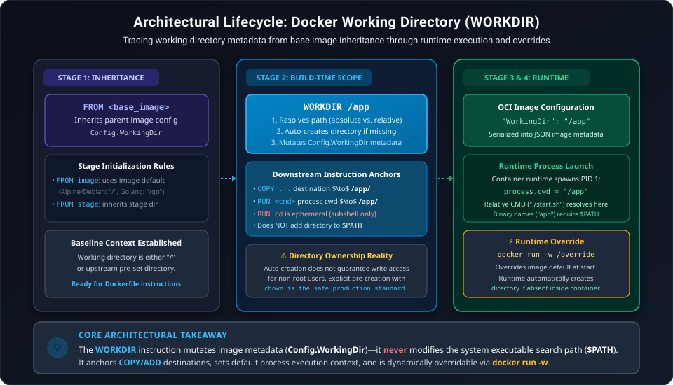
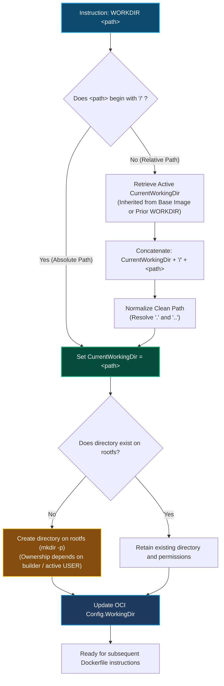
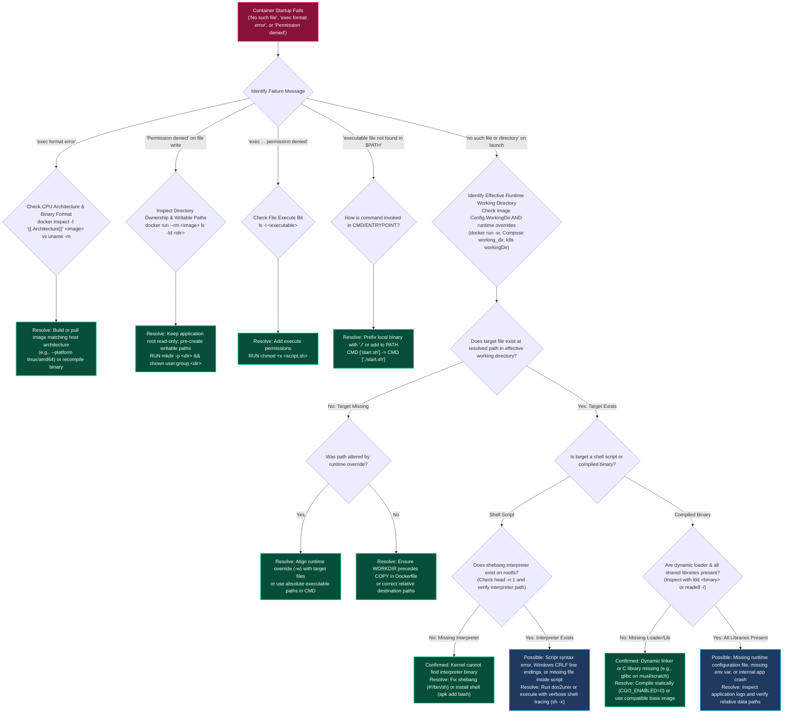

# WORKDIR Explained: Managing Execution Context and Filesystem Anchors

---

## 1. Chapter Overview & Mental Model

### 1.1 The Role of Context in Containerized Processes

Every operating system process executes within a specific filesystem context known as its **current working directory (`cwd`)**. When an application attempts to open a relative file path (such as `open("config.json")`), or when a shell script invokes a local binary (such as `./start.sh`), the kernel resolves those relative paths against the process's working directory.

In a Dockerfile, the foundational instruction for establishing this execution context is:

```dockerfile
WORKDIR /app
```

Without an explicit working directory, Dockerfile instructions and runtime containers operate in whatever directory was configured by upstream base images—or default to the root directory (`/`). Relying on default or unstated working directories introduces severe operational hazards:
- **Root Directory Clutter**: Application code, temporary build files, and runtime logs scatter across `/`, intermingling with critical operating system directories (`/etc`, `/bin`, `/var`).
- **Path Resolution Ambiguity**: Relative destination paths in `COPY` and `ADD` instructions become unpredictable across different base distributions.
- **Security Exposure**: Running processes in `/` complicates filesystem isolation and boundary enforcement, particularly when implementing non-root user policies.

Declaring an explicit working directory provides a clean, predictable filesystem anchor for both image construction and runtime container execution.

### 1.2 Declarative Configuration vs. Ephemeral Shell State

A frequent point of confusion among engineers new to Docker is the difference between `WORKDIR` and running a shell directory change command:

```dockerfile
# Anti-Pattern: Does NOT persist across instructions
RUN cd /app

# Correct Pattern: Persists across build and runtime
WORKDIR /app
```

The difference stems from how Docker executes build instructions:
- **`RUN cd /app` executes in an ephemeral subshell**: The Docker builder forks an isolated container running `/bin/sh -c "cd /app"`. The directory change modifies only the virtual memory and process table of that specific subshell process. When the process exits, the subshell terminates. The filesystem diff produced by that step contains no modified files, and image configuration metadata remains completely unchanged. The subsequent Dockerfile instruction executes back in whatever working directory was previously active.
- **`WORKDIR /app` mutates image configuration metadata**: `WORKDIR` updates the OCI image configuration (`Config.WorkingDir`). It persists across all subsequent build instructions (`COPY`, `ADD`, `RUN`) and becomes the default working directory when a container is launched from the image (`CMD`, `ENTRYPOINT`).

```
RUN cd /app:   [Subshell Process] ──> chdir(/app) ──> Process Exits ──> State Lost
WORKDIR /app: [Image Metadata]   ──> Config.WorkingDir = "/app"    ──> State Persists
```

### 1.3 Distinguishing WORKDIR from COPY and PATH

To reason accurately about Docker image assembly, engineers must distinguish `WORKDIR` from two related concepts:

1. **`WORKDIR` vs. `COPY` Build Context**:
   - The **build context** is the set of local files sent from the host machine to the Docker daemon or BuildKit builder during `docker build`.
   - `WORKDIR` controls only the **destination path** within the image filesystem where relative files land.
   - `WORKDIR` never modifies or restricts where the builder reads files on the host machine.
2. **`WORKDIR` vs. `$PATH` Execution Search Path**:
   - `WORKDIR` defines where a process starts (`process.cwd`).
   - `$PATH` defines the ordered list of directories the operating system searches when a command is invoked without an explicit path (e.g., `python`, `node`, `curl`).
   - Declaring `WORKDIR /app` does **not** add `/app` to `$PATH`. If `/app/start.sh` is an executable, invoking `CMD ["start.sh"]` will fail with an executable-not-found error unless invoked as `./start.sh`, invoked via absolute path `/app/start.sh`, or unless `/app` is explicitly appended to `$PATH` via `ENV PATH="/app:$PATH"`.

### 1.4 What You Will Learn & Prerequisites

This chapter covers:
- **Working Directory Lifecycle**: Tracing context from base images through build steps to runtime.
- **Path Resolution Mechanics**: Absolute vs. relative path chaining and base image defaults.
- **Directory Creation & Permissions**: How Docker auto-creates directories, builder ownership differences, and the non-root permission trap.
- **Instruction Interactions**: How `WORKDIR` anchors `COPY`, `ADD`, `RUN`, `CMD`, `ENTRYPOINT`, and `USER`.
- **Multi-Stage Scope & Runtime Overrides**: Managing stage boundaries and overriding working directories via CLI and orchestrators.
- **Operational Troubleshooting**: Diagnosing missing file errors, linker mistakes, and permission denials.

**Prerequisites**: Understanding of base images from [Chapter 01: The FROM Instruction](01-from-instruction.md) and an active Docker daemon.
**Estimated Reading Time**: 12–15 minutes (plus 10–15 minutes for optional hands-on laboratory execution).

---

## 2. The Visual Mental Model

### 2.1 The Working Directory Lifecycle

The working directory is not merely a build-time convenience; it is an architectural property that travels through four distinct phases of an image's lifecycle:



*Figure 1: Architectural lifecycle of the Docker working directory from base image inheritance through build-time operations, image serialization, and runtime process execution.*

1. **Phase 1: Base Image Inheritance**: When a build stage begins with `FROM`, the builder reads the parent image's `Config.WorkingDir`. If the parent image specified a working directory, that directory becomes the initial baseline. If unset, it defaults to `/`.
2. **Phase 2: Build-Time Layer Operations**: Each `WORKDIR` instruction parses its path argument, creates the directory on the image rootfs if absent, updates the active working directory, anchors relative destinations for `COPY`/`ADD`, and sets the execution context for `RUN`.
3. **Phase 3: Image Metadata Serialization**: When image assembly finishes, the final working directory path is serialized into the OCI Image Configuration JSON under the key `.Config.WorkingDir`.
4. **Phase 4: Runtime Execution & Overrides**: When a container starts, the container runtime (`runc`/`containerd`) reads `WorkingDir` and sets the process's working directory before launching PID 1. If an operator passes `--workdir` / `-w` to `docker run`, the runtime dynamically overrides the image default.

### 2.2 Filesystem Destination Anchor vs. Process Execution Context

Architecturally, `WORKDIR` fulfills two distinct responsibilities within a single instruction:

| Architectural Role | Affected Instructions | Operational Mechanism |
| :--- | :--- | :--- |
| **Filesystem Destination Anchor** | `COPY`, `ADD` | Provides the target directory on the image rootfs against which relative destination paths resolve (e.g., `COPY . .` lands at `${WORKDIR}/`). |
| **Process Execution Context** | `RUN`, `CMD`, `ENTRYPOINT` | Defines the process working directory (`process.cwd`) passed to the kernel `chdir()` syscall prior to executing shell commands or application binaries. |

Separating these two responsibilities in your mental model makes diagnosing build failures significantly easier: an error during `COPY` is a filesystem path resolution issue, whereas an error during `CMD` is a process execution context issue.

---

## 3. How WORKDIR Works Internally

### 3.1 OCI Image Configuration Metadata (`Config.WorkingDir`)

Under the OCI Image Specification, container images consist of two components: a series of compressed filesystem diff layers (tarballs) and an image configuration JSON blob.

The `WORKDIR` instruction creates no filesystem diff layer if the directory already exists. Instead, its primary function is modifying the image configuration blob:

```json
{
  "architecture": "amd64",
  "os": "linux",
  "config": {
    "WorkingDir": "/app",
    "User": "1000:1000",
    "Env": [
      "PATH=/usr/local/sbin:/usr/local/bin:/usr/sbin:/usr/bin:/sbin:/bin"
    ],
    "Cmd": ["python", "app.py"]
  }
}
```

You can inspect the serialized working directory of any local image using `docker inspect`:

```bash
docker inspect --format '{{.Config.WorkingDir}}' <image-name>
```

When the container runtime initializes a container, it reads `.Config.WorkingDir` and invokes the Linux system call `chdir("/app")` in the container's isolated mount namespace before executing the container's entrypoint or command.

### 3.2 Absolute and Relative Path Resolution Mechanics

The `WORKDIR` instruction accepts either **absolute** or **relative** filesystem paths. Docker evaluates these paths using a deterministic resolution algorithm:



*Figure 2: Deterministic path resolution and directory verification flow for the WORKDIR instruction.*

**Absolute Path Resolution:**
An absolute path starts with a forward slash (`/`). It completely replaces the active working directory baseline:

```dockerfile
WORKDIR /app       # Active working directory: /app
WORKDIR /var/log   # Active working directory: /var/log (reset, not appended)
```

**Relative Path Concatenation:**
A relative path does not begin with `/`. Docker evaluates relative paths by appending them to the currently active working directory:

```dockerfile
WORKDIR /app       # Active working directory: /app
WORKDIR src        # Active working directory: /app/src
WORKDIR internal   # Active working directory: /app/src/internal
```

**The First Relative Path Trap:**
If the *very first* `WORKDIR` in a Dockerfile uses a relative path, it appends to the working directory inherited from the base image:

```dockerfile
# Upstream base image defines: Config.WorkingDir = "/go" (verified via docker inspect)
FROM golang:1.22

# Relative path appends to upstream default!
WORKDIR src
# Resulting working directory is /go/src, NOT /src!
```

> [!TIP]
> **Production Recommendation: Always Use Absolute Paths**
> While relative `WORKDIR` chaining is valid Dockerfile syntax, relying on relative paths makes Dockerfiles fragile and vulnerable to changes in upstream base images. Explicitly specifying absolute paths (`WORKDIR /app`, `WORKDIR /app/src`) ensures the target path remains obvious and immutable regardless of base image updates.

### 3.3 Automatic Directory Creation and User Ownership Semantics

If the target path specified in a `WORKDIR` instruction does not exist on the image rootfs, Docker automatically creates it, including any missing parent directories (`mkdir -p` behavior).

However, automatic creation introduces a critical architectural caveat: **directory ownership and runtime write permissions**.

**Read-Only Code vs. Writable Runtime Directories:**
In secure container design, keeping application binaries and source code owned by `root:root` with read-and-execute permissions (`0755` or `0555`) is an intentional defense-in-depth practice. It prevents an unprivileged, compromised application process from modifying its own application code, injecting malicious files, or tampering with scripts at runtime.

An unprivileged application user does *not* need write access to its entire working directory. Write permissions and ownership are strictly required only for directories where the process must create or modify files at runtime—such as temporary scratch paths, cache directories, upload folders, and logging destinations (e.g., `/app/data`, `/app/logs`, or `/tmp`).

**The Non-Root Permission Trap:**
The permission trap occurs when an application running as an unprivileged user assumes it can write files directly into its working directory (such as creating a SQLite database in `/app/app.db`, writing `./runtime.lock`, or generating local cache files), but `/app` was auto-created by `root` with `0755` permissions:

```dockerfile
FROM alpine:3.20

# 1. Runs as root: auto-creates /app owned by root:root (0755)
WORKDIR /app

# 2. Creates an unprivileged application user
RUN adduser -D -u 1000 appuser

# 3. Switches runtime execution context to appuser
USER appuser

# 4. RUNTIME FAILURE: appuser cannot write to /app!
CMD ["touch", "/app/runtime.lock"]
```

When this container runs, the application attempts to create a file inside `/app`. Because `/app` is owned by `root` and permissions are `0755`, the operating system kernel denies write access (`touch: /app/runtime.lock: Permission denied`).

**Builder Variations and Unreliable Implicit Ownership:**
Do not assume that all container builders assign ownership identically:
- Across different builder engines, versions, and execution environments, automatic directory creation semantics vary or default to `root:root` ownership (e.g., standard `0755` permissions owned by UID/GID 0).
- Even when a builder attempts to assign directory ownership to the active `USER`, intermediate parent directories, base image layer caching, or pre-existing directory inodes frequently leave ownership mismatched or read-only for unprivileged processes.
- Consequently, relying on implicit directory creation for non-root users is an anti-pattern that introduces non-deterministic permission failures across development machines and CI/CD pipelines.

**The Safe Production Pattern:**
To guarantee deterministic, portable builds across all builder versions and runtimes, **never rely on implicit directory creation ownership for non-root users**. Keep application source code read-only, and explicitly pre-create and set ownership on any directories that require runtime writes:

```dockerfile
FROM alpine:3.20

# 1. Create user and explicitly pre-create dedicated writable directories
RUN adduser -D -u 1000 appuser && \
    mkdir -p /app/data /app/logs && \
    chown -R appuser:appuser /app/data /app/logs

# 2. Set working directory
WORKDIR /app

# 3. Switch to unprivileged user
USER appuser

# 4. Succeeds deterministically: writing to dedicated writable directory
CMD ["touch", "/app/data/runtime.lock"]
```

### 3.4 Dynamic Variable Expansion (`ENV` in `WORKDIR`)

The `WORKDIR` instruction supports environment variable interpolation defined by preceding `ENV` instructions:

```dockerfile
# Example 1: Direct variable expansion
ENV APP_DIR=/opt/service
ENV APP_ENV=production
WORKDIR $APP_DIR/$APP_ENV
# Resolves to: /opt/service/production

# Example 2: Default fallback expansion
# When APP_ROOT is unset or empty, evaluates to default fallback '/app':
WORKDIR ${APP_ROOT:-/app}
# When APP_ROOT is set (e.g. ENV APP_ROOT=/opt/custom), evaluates to '/opt/custom'
```

Docker parses variable references using standard shell-style substitution rules:
- Direct expansion: `$VARIABLE` or `${VARIABLE}`
- Default fallback expansion: `${VARIABLE:-word}` (evaluates to `$VARIABLE` if set and non-empty; evaluates to `word` if unset or empty).

This is particularly useful in enterprise base images where standardized directory paths are propagated across multiple application Dockerfiles via shared environment variables.

---

## 4. Interactions with Other Dockerfile Instructions

### 4.1 COPY and ADD: Source Context vs. Destination Anchors

The `COPY` and `ADD` instructions require a source path and a destination path:

```dockerfile
COPY <source_path> <destination_path>
```

`WORKDIR` fundamentally changes how `<destination_path>` is resolved:

```dockerfile
WORKDIR /app

# Relative destination: resolves to /app/requirements.txt
COPY requirements.txt .

# Nested relative destination: resolves to /app/src/
COPY src/ ./src/

# Absolute destination: bypasses WORKDIR entirely, lands at /opt/config.yaml
COPY config.yaml /opt/config.yaml
```

**Crucial Distinction**: The source argument (`requirements.txt`) is resolved relative to the **host build context**. The destination argument (`.`) is resolved relative to the **image `WORKDIR`**. Setting `WORKDIR` never allows `COPY` to access files outside the build context on the host machine.

### 4.2 RUN: Subshell Execution Context vs. Metadata Mutation

Every `RUN` instruction spawns a new container and executes commands inside a subshell (`/bin/sh -c` in shell form). The builder sets the process's current working directory to the path declared by the active `WORKDIR`:

```dockerfile
WORKDIR /app

# Executed with process.cwd = "/app"
RUN pwd
# Output: /app

# Chained command inside a SINGLE subshell process
RUN cd /tmp && pwd
# Output: /tmp

# Subsequent instruction: returns to the persistent WORKDIR!
RUN pwd
# Output: /app
```

Because each `RUN` instruction executes in a distinct container process, temporary directory changes made via `cd` are discarded when the subshell terminates. If multiple commands must execute inside a specific subdirectory without changing the image's overall working directory, chain them in a single `RUN` instruction:

```dockerfile
RUN cd /tmp && ./compile.sh && cp build/output /app/
```

### 4.3 CMD and ENTRYPOINT: Runtime Executable Resolution

When a container starts, the container runtime launches PID 1 with its working directory set to `Config.WorkingDir`.

Understanding how the runtime resolves the executable depends on how the command is structured:

```dockerfile
WORKDIR /app
```

1. **Relative Executable Path (`./start.sh`)**:
   ```dockerfile
   CMD ["./start.sh"]
   ```
   The runtime looks for `start.sh` inside the container's working directory (`/app/start.sh`). If `/app/start.sh` exists and has execute permissions (`+x`), it runs successfully.
2. **System Binary via `$PATH` (`python app.py`)**:
   ```dockerfile
   CMD ["python", "app.py"]
   ```
   The runtime searches `$PATH` to locate the `python` binary (e.g., `/usr/local/bin/python`). Once located, Python executes with `process.cwd = "/app"`, allowing Python to resolve relative file imports and arguments (like `app.py`) within `/app`.
3. **Unqualified Custom Binary (`start.sh`)**:
   ```dockerfile
   CMD ["start.sh"]
   ```
   **Failure**: If `start.sh` is located in `/app`, this command will fail with:
   `exec: "start.sh": executable file not found in $PATH`
   The system does *not* search the current working directory for executable names unless `.` is explicitly in `$PATH` (which is a known security vulnerability). Custom local scripts must always be invoked with `./` or by absolute path.

### 4.4 USER: The Non-Root Directory Permission Trap

The `USER` instruction changes the UID and GID for subsequent `RUN`, `CMD`, and `ENTRYPOINT` instructions.

As established in Section 3.3, declaring `WORKDIR /app` before `USER nonroot` creates `/app` owned by `root`. If your application code is read-only, this is often desirable for security. However, if the unprivileged process attempts to write runtime state, upload files, write logs, or create temporary caches directly in `/app` (or within subdirectories auto-created by `root`), the operation fails immediately with `EACCES: permission denied`. In production, keep application code directories read-only and explicitly pre-create dedicated writable directories (`RUN mkdir -p /app/data && chown user:group /app/data`).

---

## 5. Multi-Stage Builds & Runtime Overrides

### 5.1 Working Directory Scope Across Build Stages

In multi-stage Dockerfiles, managing working directory inheritance requires understanding the source of each stage:

```dockerfile
# ==========================================
# Stage 1: Build Environment
# ==========================================
FROM alpine:3.20 AS builder
WORKDIR /workspace
RUN echo "build output" > artifact.txt

# ==========================================
# Stage 2: Independent Runtime Stage
# ==========================================
FROM alpine:3.20 AS independent-stage
# Notice: Does NOT inherit /workspace!
# Working directory here defaults to alpine's default: /
CMD ["pwd"]

# ==========================================
# Stage 3: Inherited Stage
# ==========================================
FROM builder AS inherited-stage
# Notice: Inherits builder's complete configuration, including:
# Config.WorkingDir = "/workspace"
CMD ["pwd"]
```

**The Multi-Stage Inheritance Rules:**
1. **`FROM <independent_image>`**: Initializes a completely new build stage using that image's standalone configuration. Any `WORKDIR` declared in preceding stages is discarded. The new stage starts with the base image's working directory (typically `/` for Alpine or Debian).
2. **`FROM <previous_stage>`**: Inherits the referenced stage's image filesystem and configuration metadata, including its active `Config.WorkingDir`, `ENV`, and `USER` settings. (The Docker build context is a separate concept representing the local filesystem tree sent to the builder at build time; `FROM <previous_stage>` inherits the accumulated layers and image configuration of the preceding stage, not the build context).
3. **Artifact Copying (`COPY --from`)**: When copying build outputs across stages, the destination path resolves against the *current* stage's `WORKDIR`. Below is a complete, independently executable multi-stage build illustrating this pattern:

   ```dockerfile
   # Stage 1: Build stage generating an artifact
   FROM alpine:3.20 AS builder
   WORKDIR /workspace
   RUN echo "compiled application asset" > /workspace/artifact.txt

   # Stage 2: Runtime stage receiving the artifact
   FROM alpine:3.20
   WORKDIR /app
   # Destination '.' resolves against current stage WORKDIR (/app)
   COPY --from=builder /workspace/artifact.txt .
   CMD ["cat", "artifact.txt"]
   ```

### 5.2 Runtime Overrides (`docker run -w`)

The working directory configured in a Dockerfile establishes the **default** execution context for containers created from the image. However, operators can dynamically override this default at container launch using the `-w` or `--workdir` flag:

```bash
docker run --rm -w /custom/runtime/path my-image:v1 pwd
# Output: /custom/runtime/path
```

**Dynamic Runtime Directory Creation:**
If the path supplied to `-w` does not exist inside the image, the container runtime automatically creates the missing directory inside the container's writable container layer prior to starting the container process.

This feature is frequently utilized in continuous integration (CI) runners, where build pipelines mount host source code into a temporary path (e.g., `-v $(pwd):/workspace -w /workspace`) without rebuilding the underlying toolchain image.

### 5.3 Orchestration Overrides: Docker Compose & Kubernetes

Production container orchestrators support overriding the image's configured `WORKDIR` declaratively:

**Docker Compose:**
In Docker Compose, use the `working_dir` attribute:

```yaml
services:
  web:
    image: python-service:v1
    working_dir: /var/www/app
    volumes:
      - ./src:/var/www/app
```

**Kubernetes Pod Specification:**
In Kubernetes Pod manifests, use the `workingDir` field within the container specification:

```yaml
apiVersion: v1
kind: Pod
metadata:
  name: batch-processor
spec:
  containers:
  - name: processor
    image: worker-image:v1
    workingDir: /data/processing
    command: ["./process.sh"]
```

### 5.4 Base Image Inheritance Traps

Certain official language runtime images pre-configure a non-standard `WorkingDir` directly in their image metadata. For example:
- `golang:1.22` explicitly sets `Config.WorkingDir: "/go"` (verified via `docker image inspect --format '{{.Config.WorkingDir}}' golang:1.22`), which matches its default `GOPATH=/go` workspace.
- `php:8.3-apache` explicitly sets `Config.WorkingDir: "/var/www/html"` (verified via `docker image inspect --format '{{.Config.WorkingDir}}' php:8.3-apache`), pointing directly to the Apache DocumentRoot.

Do not confuse environment variables like `GOPATH` or the mere presence of a directory with `Config.WorkingDir`. Docker's path concatenation logic evaluates relative paths strictly against `Config.WorkingDir`, not against environment variables. If your Dockerfile starts with `FROM golang:1.22` and subsequently issues `WORKDIR src`, the resulting directory will be `/go/src`. Always inspect the base image's inherited configuration metadata (`docker image inspect --format '{{.Config.WorkingDir}}' <image>`), or consistently use absolute paths to establish an unambiguous baseline.

---

## 6. Hands-On Verification Laboratory

The following four exercises are completely self-contained and independently executable. They require only an active Docker daemon and standard terminal tools (`sh`/`bash`).

### Lab 1: Path Resolution — Absolute Paths and Relative Path Chaining

**Goal**: Verify that absolute paths establish and reset the working directory baseline, relative paths concatenate with the active baseline, and image metadata reflects the final resolved path.

**Commands**:

```bash
mkdir -p /tmp/docker-workdir-lab1 && cd /tmp/docker-workdir-lab1

# 1. Create a Dockerfile mixing absolute and relative WORKDIR instructions
cat << 'EOF' > Dockerfile
FROM alpine:3.20
WORKDIR /app
WORKDIR src
WORKDIR /var/log
WORKDIR audit
CMD ["pwd"]
EOF

# 2. Build the image
docker build -t workdir-path-lab:v1 .

# 3. Verify the runtime working directory
docker run --rm workdir-path-lab:v1

# 4. Inspect the image configuration metadata
docker inspect --format 'Configured WorkingDir: {{.Config.WorkingDir}}' workdir-path-lab:v1

# 5. Deterministic Assertion
test "$(docker run --rm workdir-path-lab:v1)" = "/var/log/audit" && \
  echo "Assertion passed: Final working directory is /var/log/audit"

# 6. Clean up temporary directory and image
cd /tmp && rm -rf /tmp/docker-workdir-lab1
docker rmi workdir-path-lab:v1
```

**Observe**: Running the container outputs `/var/log/audit`. Even though the Dockerfile began in `/app/src`, the subsequent absolute instruction `WORKDIR /var/log` reset the baseline, and `WORKDIR audit` appended to it. The `docker inspect` command confirms that `/var/log/audit` is stored in the image metadata.

**Why it matters**: Demonstrates the mathematical path concatenation rules and proves that absolute paths prevent accidental directory nesting.

---

### Lab 2: Ephemeral Subshells vs. Persistent Metadata (`RUN cd` vs. `WORKDIR`)

**Goal**: Prove that `RUN cd` only modifies an ephemeral subshell process, whereas `WORKDIR` updates persistent image configuration metadata.

**Commands**:

```bash
mkdir -p /tmp/docker-workdir-lab2 && cd /tmp/docker-workdir-lab2

# 1. Create a Dockerfile comparing RUN cd against WORKDIR
cat << 'EOF' > Dockerfile
FROM alpine:3.20
RUN mkdir -p /ephemeral && cd /ephemeral
RUN pwd > /build-step1.txt
WORKDIR /persistent
RUN pwd > /build-step2.txt
CMD ["pwd"]
EOF

# 2. Build the image
docker build -t workdir-subshell-lab:v1 .

# 3. Check what directory was active during step 1 (after RUN cd)
docker run --rm workdir-subshell-lab:v1 cat /build-step1.txt

# 4. Check what directory was active during step 2 (after WORKDIR)
docker run --rm workdir-subshell-lab:v1 cat /build-step2.txt

# 5. Check what directory is active at container runtime
docker run --rm workdir-subshell-lab:v1

# 6. Deterministic Assertion
test "$(docker run --rm workdir-subshell-lab:v1 cat /build-step1.txt)" = "/" && \
test "$(docker run --rm workdir-subshell-lab:v1)" = "/persistent" && \
  echo "Assertion passed: RUN cd did not persist (/), but WORKDIR did (/persistent)"

# 7. Clean up temporary directory and image
cd /tmp && rm -rf /tmp/docker-workdir-lab2
docker rmi workdir-subshell-lab:v1
```

**Observe**: Step 1 outputs `/` (root), proving that `RUN cd /ephemeral` had zero effect on subsequent instructions. In contrast, Step 2 and the runtime container output `/persistent`.

**Why it matters**: Confirms that subshells cannot persist process state across build layers; only instructions that mutate image configuration (`WORKDIR`) alter subsequent execution environments.

---

### Lab 3: Runtime Working Directory Overrides & Dynamic Directory Creation

**Goal**: Verify that an operator can override the default working directory using `docker run -w`, and verify that the container runtime automatically creates nonexistent paths at launch.

**Commands**:

```bash
mkdir -p /tmp/docker-workdir-lab3 && cd /tmp/docker-workdir-lab3

# 1. Create a minimal image with an initial working directory
cat << 'EOF' > Dockerfile
FROM alpine:3.20
WORKDIR /default-workdir
CMD ["pwd"]
EOF

# 2. Build the image
docker build -t workdir-override-lab:v1 .

# 3. Run with default configuration
docker run --rm workdir-override-lab:v1

# 4. Run with runtime override to a brand new, nonexistent path
docker run --rm -w /custom/dynamic/runtime workdir-override-lab:v1 pwd

# 5. Verify that the runtime actually created the directory inside the container
docker run --rm -w /custom/dynamic/runtime workdir-override-lab:v1 sh -c 'test -d /custom/dynamic/runtime && echo "Directory exists!"'

# 6. Deterministic Assertion
test "$(docker run --rm -w /custom/dynamic/runtime workdir-override-lab:v1 pwd)" = "/custom/dynamic/runtime" && \
  echo "Assertion passed: Runtime override dynamically created and entered /custom/dynamic/runtime"

# 7. Clean up temporary directory and image
cd /tmp && rm -rf /tmp/docker-workdir-lab3
docker rmi workdir-override-lab:v1
```

**Observe**: The default execution prints `/default-workdir`. Adding `-w /custom/dynamic/runtime` prints `/custom/dynamic/runtime`. The test command confirms that the container runtime automatically created the directory inside the container's writable layer before executing the process.

**Why it matters**: Shows how deployment tools and CI/CD pipelines override image defaults without modifying Dockerfiles or rebuilding images.

---

### Lab 4: The Non-Root Permission Trap — Automatic Creation vs. Explicit Ownership

**Goal**: Reproduce the common production bug where `WORKDIR` creates a directory owned by `root`, preventing an unprivileged user from writing files, and verify the standard least-privilege production solution.

**Commands**:

```bash
mkdir -p /tmp/docker-workdir-lab4 && cd /tmp/docker-workdir-lab4

# 1. Create Dockerfile.bad (The Anti-Pattern)
cat << 'EOF' > Dockerfile.bad
FROM alpine:3.20
RUN adduser -D -u 1000 appuser
WORKDIR /app
USER appuser
CMD ["touch", "/app/test.txt"]
EOF

# 2. Create Dockerfile.good (The Least-Privilege Production Standard)
cat << 'EOF' > Dockerfile.good
FROM alpine:3.20
RUN adduser -D -u 1000 appuser && \
    mkdir -p /app/data && \
    chown appuser:appuser /app/data
WORKDIR /app
USER appuser
CMD ["touch", "/app/data/test.txt"]
EOF

# 3. Build both images
docker build -f Dockerfile.bad -t workdir-perm-bad:v1 .
docker build -f Dockerfile.good -t workdir-perm-good:v1 .

# 4. Run the bad container: Observe permission failure
docker run --rm workdir-perm-bad:v1 || echo "As expected, bad image failed with permission error!"

# 5. Run the good container: Observe successful file creation in /app/data
docker run --rm workdir-perm-good:v1 && echo "Good image ran successfully!"

# 6. Inspect the directory ownership differences
echo "Inspecting directory ownership in bad image (/app):"
docker run --rm workdir-perm-bad:v1 ls -ld /app || true

echo "Inspecting directory ownership in good image (/app and /app/data):"
docker run --rm workdir-perm-good:v1 ls -ld /app /app/data

# 7. Deterministic Assertion
! docker run --rm workdir-perm-bad:v1 >/dev/null 2>&1 && \
  docker run --rm workdir-perm-good:v1 >/dev/null 2>&1 && \
  echo "Assertion passed: Bad image fails with permission error on /app; good image successfully writes to /app/data while /app remains root-owned."

# 8. Clean up temporary directory and images
cd /tmp && rm -rf /tmp/docker-workdir-lab4
docker rmi workdir-perm-bad:v1 workdir-perm-good:v1
```

**Observe**: `workdir-perm-bad:v1` fails with `touch: /app/test.txt: Permission denied` because `/app` was auto-created with `drwxr-xr-x root:root` and `appuser` lacks write permissions in `/app`. In `workdir-perm-good:v1`, `/app` remains owned by `root:root` (protecting application files and binaries from runtime tampering), while the dedicated writable subdirectory `/app/data` is explicitly owned by `appuser:appuser`. The container successfully creates `/app/data/test.txt` without granting unnecessary write permissions to the application root.

**Why it matters**: Demonstrates the principle of least privilege in container security: application code and system configuration remain immutable and owned by `root`, while unprivileged application processes are granted write permissions strictly and exclusively to dedicated runtime subdirectories (`/app/data`).

---

## 7. Troubleshooting Common WORKDIR Errors

When a container fails at startup with missing files, execution failures, or permission errors, the root cause can stem from multiple distinct mechanisms:
- **Missing Executable Path**: The binary or script does not exist at the resolved path in the effective runtime working directory (e.g., `stat ./start.sh: no such file or directory`).
- **Missing Script Interpreter (Shebang Error)**: The script file exists and has execute permissions, but the interpreter declared in its shebang line (e.g., `#!/bin/bash` in an Alpine image where only `/bin/sh` exists) is missing from the container rootfs. The operating system kernel reports `no such file or directory` for the missing interpreter, not the script itself.
- **Missing Dynamic Loader / Shared Library**: A compiled binary exists, but it was dynamically linked against a C library or dynamic loader (e.g., `/lib64/ld-linux-x86-64.so.2` in `FROM scratch` or `glibc` in an Alpine rootfs) that does not exist in the image userspace.
- **Architecture / Binary Format Mismatch (`exec format error`)**: The binary is compiled for an incompatible CPU architecture (e.g., an `x86_64` binary on an `arm64` host without emulation) or is not a valid executable file format.
- **Missing Directory Write Permissions**: Application code was kept read-only (owned by `root` with `0755`), but the unprivileged process attempted to write files directly into a directory or subdirectory lacking write permissions.
- **Internal Script / Application Mismatch**: If the target executable and its interpreter/loader exist, runtime errors may stem from Windows CRLF (`\r`) line endings causing `/bin/sh\r: not found`, missing files referenced inside the script, or application configuration lookup failures.

It is critical to distinguish the **image-configured default `WORKDIR`** (recorded in image metadata `.Config.WorkingDir`) from the **effective runtime working directory** (which may be dynamically overridden at launch via `docker run -w`, Docker Compose `working_dir`, or Kubernetes `workingDir`).

| Error Signature | Underlying Cause | Diagnostic Step | Actionable Resolution |
| :--- | :--- | :--- | :--- |
| `exec: "./start.sh": stat ./start.sh: no such file or directory` | Target executable does not exist in the *effective* runtime working directory (caused by incorrect `COPY` destination, missing `WORKDIR`, or runtime override via `-w` / Compose / Kubernetes). | Compare image metadata (`docker inspect -f '{{.Config.WorkingDir}}' <image>`) against runtime flags (`-w`); inspect directory contents with `docker run --rm <image> ls -la <effective_workdir>`. | Align `COPY` destination with `WORKDIR`, update runtime override path, or invoke command via absolute path (`CMD ["/app/start.sh"]`). |
| `exec: "./start.sh": no such file or directory` (file *does* exist!) | Missing script interpreter specified in the script's shebang line (e.g., `#!/bin/bash` in an Alpine container where only `/bin/sh` exists). | Inspect the first line of the script: `head -n 1 start.sh` and verify whether that interpreter exists inside the container rootfs. | Change shebang to POSIX `/bin/sh` or install the required interpreter package (`apk add --no-cache bash`). |
| `exec /app/binary: no such file or directory` | Missing dynamic loader or shared C library (e.g. dynamic binary in `FROM scratch` or `glibc` binary in Alpine). | Run `ldd <binary>` or `file <binary>` to inspect dynamic linker dependencies. | Compile statically (`CGO_ENABLED=0`), copy required shared libraries, or use a `slim` base image with the appropriate C library. |
| `exec ... exec format error` | Architecture mismatch between container binary and host CPU (e.g. AMD64 binary on ARM64 host without emulation). | Check image architecture: `docker inspect -f '{{.Architecture}}' <image>` vs host `uname -m`. | Build or pull an image matching the host platform (`--platform linux/amd64` or `linux/arm64`), or recompile for the target architecture. |
| `exec: "./start.sh": permission denied` | The script file lacks the executable bit (`+x`) on the container filesystem, or the underlying volume is mounted with `noexec`. | Inspect file permissions inside image: `docker run --rm <image> ls -l <path>/start.sh`. | Ensure build context file has execute permissions or add `RUN chmod +x /app/start.sh` in the Dockerfile. |
| `executable file not found in $PATH` | Custom executable invoked by bare name (e.g. `CMD ["start.sh"]`) rather than relative or absolute path. `WORKDIR` does not modify `$PATH`. | Inspect `CMD` or `ENTRYPOINT` syntax in Dockerfile. | Prefix local script with `./` (e.g., `CMD ["./start.sh"]`), use absolute path (`CMD ["/app/start.sh"]`), or append directory to `$PATH` via `ENV PATH="/app:$PATH"`. |
| `Permission denied` / `EACCES` on write/touch | Process running as unprivileged `USER` attempted to write into a directory owned by `root:root` (`0755`). | Check directory ownership: `docker run --rm <image> ls -ld <workdir>`. | Keep application code read-only, but explicitly pre-create dedicated writable directories: `RUN mkdir -p /app/data && chown user:group /app/data`. |
| `FileNotFoundError: 'config.yaml'` at runtime | Application accessed a relative file path, but the *effective* runtime working directory differed from build time (e.g. overridden by orchestrator). | Check effective runtime directory via `pwd` and verify application configuration path. | Standardize application paths using absolute paths (`/app/config.yaml`) or ensure orchestration configs preserve the expected working directory. |
| Files landed at `/go/src/app` or `/app/app` | Relative `WORKDIR` instruction appended to an unexpected upstream base image default directory. | Inspect base image working directory: `docker inspect -f '{{.Config.WorkingDir}}' <base_image>`. | Replace relative `WORKDIR src` with absolute `WORKDIR /app` to explicitly reset the path baseline. |

### 7.1 Diagnostic Decision Flowchart

When diagnosing container launch failures involving missing files, executable lookup errors, or permission denials, follow this structured decision tree:



*Figure 3: Structured diagnostic decision tree for troubleshooting runtime path mismatches, executable search failures, and permission errors.*

---

## 8. Architectural Knowledge Check

Test your understanding of working directory mechanics with these four real-world engineering scenarios:

<details>
<summary><strong>Scenario 1: In a multi-stage Dockerfile, why does Stage 2 fail to find files copied relative to <code>.</code> if Stage 1 declared <code>WORKDIR /workspace</code>?</strong></summary>

<br>

**Answer:**
Each build stage initialized with `FROM <independent_image>` starts with a fresh image configuration, inheriting only what the base image defines. Stage 1's `WORKDIR /workspace` is discarded. When Stage 2 begins (`FROM alpine:3.20`), its working directory resets to Alpine's default (`/`). If Stage 2 runs `COPY --from=stage1 /workspace/output.json .`, the file lands at `/output.json` on the root filesystem, rather than `/workspace/output.json` or `/app/output.json`. To prevent this, Stage 2 must explicitly declare its own `WORKDIR /app` before copying artifacts.
</details>

<br>

<details>
<summary><strong>Scenario 2: An engineer writes <code>WORKDIR app</code> followed by <code>WORKDIR src</code> in a Dockerfile starting with <code>FROM golang:1.22</code>. What is the resulting working directory, and why?</strong></summary>

<br>

**Answer:**
The resulting working directory is `/go/app/src`. The official `golang:1.22` base image specifies `Config.WorkingDir = "/go"` in its image metadata (verified via `docker image inspect`). Because the first instruction (`WORKDIR app`) uses a relative path, it appends to the inherited base image directory (`/go/app`). The second relative instruction (`WORKDIR src`) appends further (`/go/app/src`). To set the working directory to `/app/src`, the engineer must use an absolute path: `WORKDIR /app/src`.
</details>

<br>

<details>
<summary><strong>Scenario 3: A security scanner requires containers to run as an unprivileged user. After adding <code>USER 1000</code>, the application crashes on startup with <code>EACCES: permission denied</code> while writing to <code>/app/cache/</code>. What caused this, and what is the fix?</strong></summary>

<br>

**Answer:**
`WORKDIR /app` was executed before `USER 1000`, causing Docker to auto-create `/app` owned by `root:root` with permissions `0755`. When the unprivileged user (UID 1000) attempted to create `/app/cache/` at runtime, the operating system kernel blocked the write operation. While keeping application code directories read-only is an intentional security best practice, any directory where the unprivileged process must write at runtime requires appropriate ownership or write permissions. The fix is to explicitly pre-create the dedicated writable directory and assign ownership to UID 1000 before switching users:
```dockerfile
RUN mkdir -p /app/cache && chown -R 1000:1000 /app/cache
WORKDIR /app
USER 1000
```
</details>

<br>

<details>
<summary><strong>Scenario 4: If an image defines <code>WORKDIR /app</code> and <code>CMD ["./run.sh"]</code>, what happens if an operator runs the container with <code>docker run -w /var/data &lt;image&gt;</code>?</strong></summary>

<br>

**Answer:**
The container fails immediately on launch with:
`docker: Error response from daemon: failed to create task for container: failed to create shim task: OCI runtime create failed: runc create failed: unable to start container process: exec: "./run.sh": stat ./run.sh: no such file or directory`
The runtime flag `-w /var/data` dynamically overrides the process's working directory to `/var/data`. The executable was specified as `./run.sh` (relative to `cwd`), so the kernel searches for `/var/data/run.sh`. Because `run.sh` resides in `/app/run.sh`, the file is not found. To allow runtime overrides, either invoke the script using an absolute path (`CMD ["/app/run.sh"]`) or place the script in a directory included in `$PATH`.
</details>

---

## 9. Key Engineering Takeaways & Next Steps

1. **`WORKDIR` mutates metadata, not process memory**: Unlike `RUN cd`, which only affects an ephemeral subshell, `WORKDIR` permanently sets `.Config.WorkingDir` in the image configuration JSON.
2. **`WORKDIR` sets context, not `$PATH`**: Setting `WORKDIR /app` does not allow invoking `/app/start.sh` as `start.sh`. Local scripts must be invoked with `./start.sh` or an absolute path.
3. **Always prefer absolute paths**: Relative `WORKDIR` instructions append to whatever working directory was configured by upstream base images, leading to unintended nested directories like `/go/src`.
4. **Implicit auto-creation ownership is unreliable across builders**: Automatic directory creation semantics vary across builder implementations and execution environments, frequently defaulting to `root:root` (`0755`) or leaving parent directories mismatched. Relying on implicit directory creation ownership for non-root users is an anti-pattern. While keeping application code directories read-only is a recommended defense-in-depth practice, any directory requiring runtime writes (such as data, cache, or log directories) must be explicitly created and assigned appropriate ownership or permissions (`mkdir -p && chown`).
5. **Stage boundaries reset working directories**: `FROM <image>` starts fresh with the base image's default working directory; only `FROM <previous_stage>` inherits an earlier stage's `WORKDIR`.
6. **Runtime overrides are dynamic**: Operators can override `WORKDIR` at runtime using `docker run -w`, Docker Compose `working_dir`, or Kubernetes `workingDir`. The container runtime dynamically creates missing override directories on the container's writable layer before starting the container process.

---

### What's Next: The `COPY` Instruction

Now that you have established a reliable filesystem anchor and runtime context, how do you transfer source code and configuration files into that directory? In [Chapter 03: The COPY Instruction](03-copy-instruction.md), we explore build context boundaries, layer caching mechanics, multi-stage transfers, and file permission preservation.
